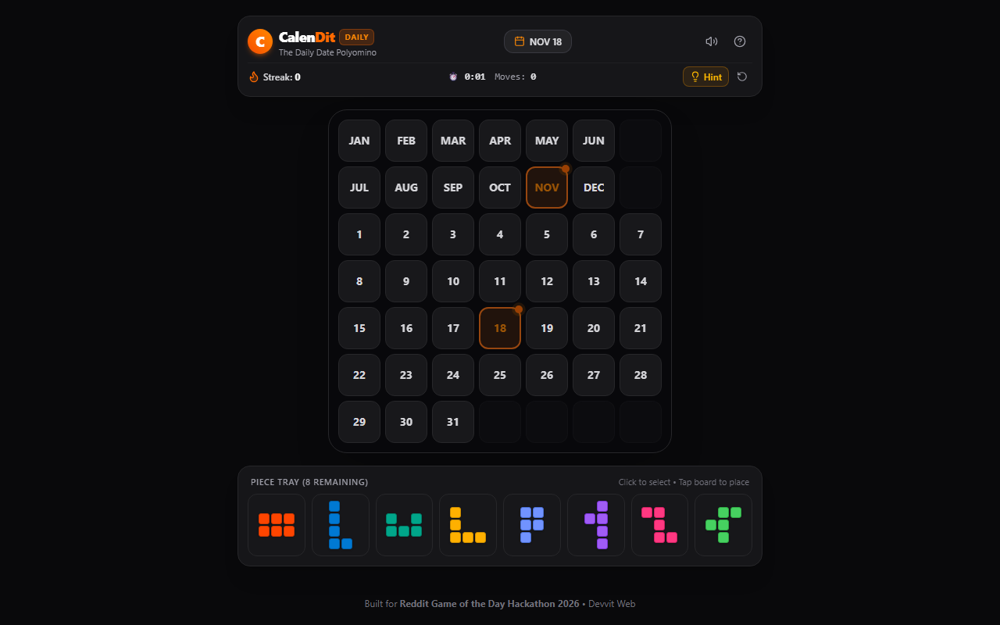

# CalenDit 🧩

> **The Daily Date-Polyomino Puzzle built for Reddit's Game of the Day Hackathon 2026**

[](https://developers.reddit.com/)
[](https://react.dev/)
[](https://vitejs.dev/)
[](https://tailwindcss.com/)

---

## 📸 Screenshots & Gameplay




> 🎥 **Demo Walkthrough Video:** [Watch the demo video on GitHub](https://github.com/adarsh-panicker/CalenDit/blob/main/recordings/calendit_demo.mp4)

---

**CalenDit** is a tactile, daily calendar polyomino puzzle designed specifically for Reddit communities using the **Devvit Web** platform. 

Inspired by the viral physical desk puzzle *"A-Puzzle-A-Day"*, players are given an irregular 43-tile calendar board listing the 12 months and 31 days. The objective is to place all 8 geometric polyomino pieces onto the board so that **every single tile is covered EXCEPT today's Month and Day**!

---

## ✨ Key Features

- **Automatic Daily Challenge:** Automatically locks onto today's date (e.g., `NOV 18`) with illuminated target indicators.
- **8 Proven Polyomino Pieces:**
  - $2 \times 3$ Rectangular Block (Reddit OrangeRed)
  - L-Pentomino (Reddit Blue)
  - U-Pentomino (Teal)
  - V-Pentomino (Karma Gold)
  - P-Pentomino (Periwinkle)
  - Y-Pentomino (Purple)
  - Z-Pentomino (Neon Berry)
  - F-Pentomino (Mint Green)
- **Tactile & Fluid Controls:**
  - Click any piece in the tray to select, click board to place.
  - **Rotate:** Press `R` or click the Rotate button ($90^\circ$ clockwise).
  - **Flip:** Press `F` or click the Flip button (horizontal reflection).
  - **Undo / Pick Up:** Click any placed piece on the board to instantly return it to your hand.
- **Mathematical DFS Solver & Hints:**
  - Includes a fast backtracking depth-first search solver (`src/utils/solver.ts`) that guarantees mathematical solvability for all 366 dates and can provide a hint by placing one piece accurately.
- **Reddit-Style Spoiler Share Card:**
  - Generates Wordle-style comment spoiler grids ready to paste into Reddit discussion threads:
    ```text
    CalenDit — NOV 18 🧩
    ⏱️ Time: 2:14 | 🔄 Moves: 14
    🔥 Streak: 5 days
    [ 🟧 🟦 🟩 🟨 🟪 🟫 🟥 ⬜ ]
    Play today's puzzle in the post!
    ```
- **"Archive / Birthday" Free Play:**
  - Lets players choose any date of the year (birthdays, anniversaries, or previous daily puzzles) to solve in practice mode.
- **Synthesized Web Audio:**
  - Zero external sound files—features custom procedural audio feedback (clicks, rotates, magnetic snaps, error buzz, and victory fanfare) powered directly by the Web Audio API.

---

## 📐 Mathematical Proof & Board Geometry

The board consists of a $7 \times 7$ grid with 6 blocked outer cells, leaving **43 active calendar cells**:
- **Rows 0–1:** 6 columns of months each (12 months total)
- **Rows 2–5:** 7 columns of days (Days 1–28)
- **Row 6:** 3 columns of days (Days 29–31)

$$\text{Total Pieces Area} = 1 \times 6 \text{ (rectangle)} + 7 \times 5 \text{ (pentominoes)} = 41 \text{ cells}$$

$$\text{Uncovered Cells} = 43 \text{ active tiles} - 41 \text{ piece tiles} = \mathbf{2 \text{ cells (Month + Day)}}$$

Every single calendar combination has between dozens and hundreds of unique valid solutions across the year.

---

## ⚖️ License
MIT License. Built for the **Reddit Game of the Day Hackathon 2026**.
